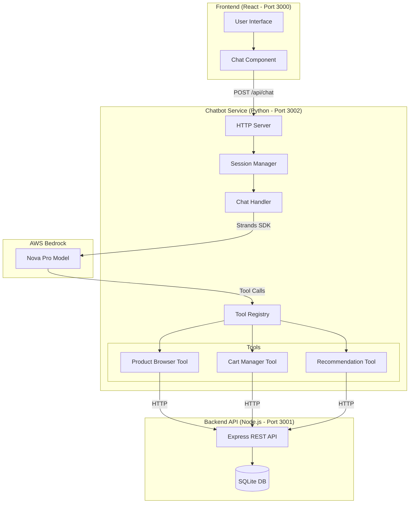

# Shopping Assistant Chatbot - Design Document

## Overview

The Shopping Assistant Chatbot is a conversational AI service that enhances the e-commerce application by providing natural language interaction for product browsing, cart management, and personalized recommendations. The service is implemented as a Python-based HTTP server that integrates AWS Bedrock Nova Pro via the Strands SDK, communicating with the existing Node.js backend through REST APIs.

### Key Design Goals

- Provide natural language interface for shopping tasks
- Maintain conversation context across user sessions
- Integrate seamlessly with existing backend services
- Leverage AWS Bedrock Nova Pro for advanced language understanding
- Support tool-based function calling for structured operations
- Ensure resilient error handling and graceful degradation

### Technology Stack

- **Language**: Python 3.11+
- **AI Framework**: Strands SDK for AWS Bedrock integration
- **LLM**: AWS Bedrock Nova Pro (amazon.nova-pro-v1:0)
- **HTTP Server**: Flask or FastAPI
- **Backend Integration**: HTTP client (requests library)
- **Session Management**: In-memory store with TTL (Redis optional for production)
- **Configuration**: Environment variables via python-dotenv

## Architecture

### High-Level Architecture



### Component Interaction Flow

1. **User Request**: Frontend sends chat message to chatbot service
2. **Session Retrieval**: Service retrieves or creates conversation session
3. **Context Building**: Previous messages added to conversation context
4. **LLM Invocation**: Strands SDK sends request to Bedrock Nova Pro with available tools
5. **Tool Execution**: Model may invoke tools (product search, cart operations)
6. **Backend Integration**: Tools make HTTP calls to Node.js backend
7. **Response Generation**: Model generates natural language response
8. **Session Update**: Conversation history updated with new exchange
9. **Response Return**: JSON response sent back to frontend

## Components and Interfaces

### 1. HTTP Server Component

**Responsibility**: Handle incoming HTTP requests and route to appropriate handlers

**Framework**: FastAPI (preferred for async support and automatic OpenAPI docs)

**Endpoints**:

```python
POST /api/chat
  Request Body:
    {
      "message": str,           # User's message
      "session_id": str | None  # Optional session ID for context
    }
  
  Response:
    {
      "response": str,          # Chatbot's response
      "session_id": str,        # Session ID for future requests
      "timestamp": str          # ISO 8601 timestamp
    }
  
  Error Response:
    {
      "error": str,             # Error message
      "details": str | None     # Additional error details
    }

GET /api/health
  Response:
    {
      "status": "healthy" | "unhealthy",
      "bedrock_available": bool,
      "backend_available": bool,
      "timestamp": str
    }
```

**Configuration**:
- Port: 3002
- CORS: Enabled for frontend origin (http://localhost:3000)
- Timeout: 30 seconds for chat requests
- Max request size: 10KB

### 2. Session Manager Component

**Responsibility**: Manage conversation sessions and context history

**Data Structure**:

```python
@dataclass
class ConversationMessage:
    role: str  # "user" | "assistant"
    content: str
    timestamp: datetime
    tool_calls: list[dict] | None = None

@dataclass
class Session:
    session_id: str
    messages: list[ConversationMessage]
    created_at: datetime
    last_accessed: datetime
    metadata: dict  # User preferences, cart state hints
```

**Operations**:
- `create_session() -> str`: Generate new session ID (UUID4)
- `get_session(session_id: str) -> Session | None`: Retrieve session
- `update_session(session_id: str, message: ConversationMessage)`: Add message
- `cleanup_expired_sessions()`: Remove sessions older than TTL (30 minutes)

**Storage**: In-memory dictionary with periodic cleanup (background task)

### 3. Chat Handler Component

**Responsibility**: Orchestrate LLM interactions via Strands SDK

**Key Methods**:

```python
class ChatHandler:
    def __init__(self, bedrock_client, tool_registry):
        self.client = bedrock_client
        self.tools = tool_registry
    
    async def process_message(
        self, 
        message: str, 
        session: Session
    ) -> str:
        """Process user message and return assistant response"""
        pass
    
    def _build_context(self, session: Session) -> list[dict]:
        """Convert session messages to Strands format"""
        pass
    
    async def _execute_tool_calls(self, tool_calls: list) -> list[dict]:
        """Execute tool calls and return results"""
        pass
```

**Strands SDK Integration**:
- Model: `amazon.nova-pro-v1:0`
- Temperature: 0.7 (balanced creativity/consistency)
- Max tokens: 2048
- Tool choice: Auto (model decides when to use tools)

### 4. Tool Registry Component

**Responsibility**: Register and execute tools for LLM function calling

**Tool Definitions**:

```python
# Tool 1: Product Browser
{
    "name": "browse_products",
    "description": "Search and browse available products in the store",
    "parameters": {
        "type": "object",
        "properties": {
            "query": {
                "type": "string",
                "description": "Search query to filter products (optional)"
            },
            "product_id": {
                "type": "integer",
                "description": "Specific product ID to get details (optional)"
            }
        }
    }
}

# Tool 2: Cart Manager
{
    "name": "manage_cart",
    "description": "View, add, update, or remove items from shopping cart",
    "parameters": {
        "type": "object",
        "properties": {
            "action": {
                "type": "string",
                "enum": ["view", "add", "update", "remove"],
                "description": "Cart operation to perform"
            },
            "product_id": {
                "type": "integer",
                "description": "Product ID for add/update/remove operations"
            },
            "quantity": {
                "type": "integer",
                "description": "Quantity for add/update operations"
            },
            "cart_item_id": {
                "type": "integer",
                "description": "Cart item ID for update/remove operations"
            }
        },
        "required": ["action"]
    }
}

# Tool 3: Product Recommendations
{
    "name": "get_recommendations",
    "description": "Get personalized product recommendations based on criteria",
    "parameters": {
        "type": "object",
        "properties": {
            "category": {
                "type": "string",
                "description": "Product category or type"
            },
            "price_range": {
                "type": "object",
                "properties": {
                    "min": {"type": "number"},
                    "max": {"type": "number"}
                }
            },
            "limit": {
                "type": "integer",
                "description": "Maximum number of recommendations",
                "default": 5
            }
        }
    }
}
```

**Tool Implementations**:

Each tool is a Python class implementing:
```python
class Tool(ABC):
    @abstractmethod
    async def execute(self, **kwargs) -> dict:
        """Execute tool with given parameters"""
        pass
    
    @abstractmethod
    def get_definition(self) -> dict:
        """Return tool definition for LLM"""
        pass
```

### 5. Backend Integration Component

**Responsibility**: HTTP client for communicating with Node.js backend

**Configuration**:
```python
BACKEND_BASE_URL = "http://localhost:3001"
REQUEST_TIMEOUT = 10  # seconds
RETRY_ATTEMPTS = 3
RETRY_BACKOFF = 1.5  # exponential backoff multiplier
```

**API Client Methods**:
```python
class BackendClient:
    async def get_products(self) -> list[dict]:
        """GET /api/products"""
        pass
    
    async def get_product_details(self, product_id: int) -> dict:
        """GET /api/products/:id"""
        pass
    
    async def get_cart(self) -> list[dict]:
        """GET /api/cart"""
        pass
    
    async def add_to_cart(self, product_id: int, quantity: int) -> dict:
        """POST /api/cart"""
        pass
    
    async def update_cart_item(self, cart_id: int, quantity: int) -> dict:
        """PUT /api/cart/:id"""
        pass
    
    async def remove_cart_item(self, cart_id: int) -> dict:
        """DELETE /api/cart/:id"""
        pass
```

**Error Handling**:
- Connection errors: Retry with exponential backoff
- Timeout errors: Return graceful error message
- 404 errors: Return "not found" message
- 500 errors: Log and return generic error

## Data Models

### Request/Response Models

```python
from pydantic import BaseModel, Field
from datetime import datetime

class ChatRequest(BaseModel):
    message: str = Field(..., min_length=1, max_length=2000)
    session_id: str | None = Field(None, pattern=r'^[a-f0-9-]{36}$')

class ChatResponse(BaseModel):
    response: str
    session_id: str
    timestamp: datetime

class ErrorResponse(BaseModel):
    error: str
    details: str | None = None

class HealthResponse(BaseModel):
    status: str
    bedrock_available: bool
    backend_available: bool
    timestamp: datetime
```

### Internal Models

```python
from dataclasses import dataclass
from datetime import datetime
from typing import Literal

@dataclass
class ConversationMessage:
    role: Literal["user", "assistant", "system"]
    content: str
    timestamp: datetime
    tool_calls: list[dict] | None = None
    tool_results: list[dict] | None = None

@dataclass
class Session:
    session_id: str
    messages: list[ConversationMessage]
    created_at: datetime
    last_accessed: datetime
    metadata: dict[str, any]
    
    def add_message(self, message: ConversationMessage):
        self.messages.append(message)
        self.last_accessed = datetime.utcnow()
    
    def get_context_window(self, max_messages: int = 20) -> list[ConversationMessage]:
        """Return recent messages for context"""
        return self.messages[-max_messages:]

@dataclass
class ToolCall:
    tool_name: str
    parameters: dict
    call_id: str

@dataclass
class ToolResult:
    call_id: str
    result: dict
    error: str | None = None
```

### Configuration Model

```python
from pydantic_settings import BaseSettings

class Settings(BaseSettings):
    # AWS Configuration
    aws_region: str = "us-east-1"
    aws_access_key_id: str
    aws_secret_access_key: str
    bedrock_model_id: str = "amazon.nova-pro-v1:0"
    
    # Server Configuration
    server_host: str = "0.0.0.0"
    server_port: int = 3002
    
    # Backend Configuration
    backend_base_url: str = "http://localhost:3001"
    backend_timeout: int = 10
    
    # Session Configuration
    session_ttl_minutes: int = 30
    max_context_messages: int = 20
    
    # LLM Configuration
    llm_temperature: float = 0.7
    llm_max_tokens: int = 2048
    
    class Config:
        env_file = ".env"
        env_file_encoding = "utf-8"
```

## Integration Patterns

### Frontend Integration

The frontend will add a chat interface component:

```javascript
// Pseudocode for frontend integration
const ChatWidget = () => {
  const [messages, setMessages] = useState([]);
  const [sessionId, setSessionId] = useState(null);
  
  const sendMessage = async (message) => {
    const response = await fetch('http://localhost:3002/api/chat', {
      method: 'POST',
      headers: { 'Content-Type': 'application/json' },
      body: JSON.stringify({ message, session_id: sessionId })
    });
    
    const data = await response.json();
    setSessionId(data.session_id);
    setMessages([...messages, 
      { role: 'user', content: message },
      { role: 'assistant', content: data.response }
    ]);
  };
  
  return <ChatInterface messages={messages} onSend={sendMessage} />;
};
```

### Backend API Integration

The chatbot service acts as a client to the existing backend:

```
Chatbot Service          Backend API
     |                        |
     |-- GET /api/products -->|
     |<-- Product List --------|
     |                        |
     |-- POST /api/cart ------>|
     |<-- Success -------------|
     |                        |
```

**Authentication**: Currently none (future: session tokens)

**Rate Limiting**: Respect backend rate limits (future enhancement)

### AWS Bedrock Integration

```python
# Strands SDK usage pattern
from strands import Strands

client = Strands(
    aws_access_key_id=settings.aws_access_key_id,
    aws_secret_access_key=settings.aws_secret_access_key,
    region_name=settings.aws_region
)

response = await client.chat.completions.create(
    model=settings.bedrock_model_id,
    messages=conversation_history,
    tools=tool_definitions,
    temperature=settings.llm_temperature,
    max_tokens=settings.llm_max_tokens
)
```

## Correctness Properties

*A property is a characteristic or behavior that should hold true across all valid executions of a system-essentially, a formal statement about what the system should do. Properties serve as the bridge between human-readable specifications and machine-verifiable correctness guarantees.*


### Property 1: Valid chat requests return success

*For any* valid chat message (non-empty string under 2000 characters), when sent to the /api/chat endpoint, the service should return HTTP status 200 with a response containing a message and session_id.

**Validates: Requirements 2.2**

### Property 2: Session context is maintained across requests

*For any* valid session_id provided in a chat request, the service should retrieve the existing conversation history and include it in the context sent to the LLM.

**Validates: Requirements 2.4, 5.2**

### Property 3: Product browsing tool calls correct backend endpoint

*For any* invocation of the browse_products tool without a product_id parameter, the tool should make a GET request to the backend /api/products endpoint.

**Validates: Requirements 3.2**

### Property 4: Product details tool calls correct backend endpoint

*For any* invocation of the browse_products tool with a specific product_id parameter, the tool should make a GET request to the backend /api/products/:id endpoint with the correct ID.

**Validates: Requirements 3.3**

### Property 5: Cart view tool calls correct backend endpoint

*For any* invocation of the manage_cart tool with action="view", the tool should make a GET request to the backend /api/cart endpoint.

**Validates: Requirements 4.2**

### Property 6: Cart add tool calls correct backend endpoint

*For any* invocation of the manage_cart tool with action="add", the tool should make a POST request to the backend /api/cart endpoint with the provided product_id and quantity in the request body.

**Validates: Requirements 4.3**

### Property 7: Cart update tool calls correct backend endpoint

*For any* invocation of the manage_cart tool with action="update", the tool should make a PUT request to the backend /api/cart/:id endpoint with the provided cart_item_id and quantity.

**Validates: Requirements 4.4**

### Property 8: Cart remove tool calls correct backend endpoint

*For any* invocation of the manage_cart tool with action="remove", the tool should make a DELETE request to the backend /api/cart/:id endpoint with the provided cart_item_id.

**Validates: Requirements 4.5**

### Property 9: New sessions are created for requests without session_id

*For any* chat request that does not include a session_id, the service should create a new session with a unique UUID and return that session_id in the response.

**Validates: Requirements 5.1**

### Property 10: Conversation history is updated after each exchange

*For any* completed conversation exchange, both the user message and the assistant response should be added to the session's message history in the correct order.

**Validates: Requirements 5.3**

### Property 11: Expired sessions are cleaned up

*For any* session that has not been accessed for more than the configured TTL (30 minutes), the session should be removed from memory during the cleanup process.

**Validates: Requirements 5.4**

### Property 12: Tool calls are executed before final response

*For any* LLM response that includes tool calls, all tool calls should be executed and their results collected before the final assistant response is generated.

**Validates: Requirements 6.2**

### Property 13: Tool results are provided to LLM

*For any* executed tool call, the result should be formatted and included in the subsequent LLM request to enable the model to generate an informed response.

**Validates: Requirements 6.3**

### Property 14: Backend timeouts trigger retry logic

*For any* backend API request that times out, the service should retry the request up to 3 times with exponential backoff before returning an error.

**Validates: Requirements 7.3**

### Property 15: Unexpected errors are logged and handled gracefully

*For any* unexpected error that occurs during request processing, the error should be logged with full details and a generic error message should be returned to the user without exposing internal details.

**Validates: Requirements 7.5**

### Property 16: Recommendations tool fetches from backend

*For any* invocation of the get_recommendations tool, the tool should make a GET request to the backend /api/products endpoint to retrieve the product catalog.

**Validates: Requirements 9.1**

### Property 17: Price range filtering is applied correctly

*For any* invocation of get_recommendations with a price_range parameter, all returned products should have prices within the specified min and max values (inclusive).

**Validates: Requirements 9.2**

### Property 18: Category filtering is applied correctly

*For any* invocation of get_recommendations with a category parameter, all returned products should match the specified category based on name or description.

**Validates: Requirements 9.3**

### Property 19: Result limit is respected

*For any* invocation of get_recommendations with a limit parameter, the number of returned products should not exceed the specified limit value.

**Validates: Requirements 9.4**

### Property 20: Health check verifies Bedrock connectivity

*For any* health check request, the service should attempt to verify AWS Bedrock connectivity and include the result in the bedrock_available field of the response.

**Validates: Requirements 10.2**

### Property 21: Health check verifies backend connectivity

*For any* health check request, the service should attempt to verify backend API connectivity and include the result in the backend_available field of the response.

**Validates: Requirements 10.3**

### Property 22: Health status reflects dependency availability

*For any* health check request where at least one dependency (Bedrock or backend) is unavailable, the overall health status should be set to "unhealthy".

**Validates: Requirements 10.4**

## Error Handling

### Error Categories

**1. Client Errors (4xx)**
- Invalid request format: Return 400 with validation details
- Missing required fields: Return 400 with field names
- Invalid session_id format: Return 400 with format requirements
- Message too long: Return 400 with length limit

**2. Backend Integration Errors**
- Connection refused: Retry with backoff, then return 503
- Timeout: Retry up to 3 times, then return 504
- 404 Not Found: Return graceful message to user
- 500 Server Error: Log and return generic error

**3. AWS Bedrock Errors**
- Authentication failure: Log and return 500
- Rate limiting: Implement exponential backoff
- Model unavailable: Return 503 with retry-after header
- Invalid request: Log and return 500

**4. Internal Errors**
- Session storage failure: Log and continue without context
- Tool execution failure: Log and inform LLM of failure
- Unexpected exceptions: Log with stack trace, return 500

### Error Response Format

All errors follow consistent format:
```json
{
  "error": "Human-readable error message",
  "details": "Additional context (optional)",
  "timestamp": "2024-01-15T10:30:00Z"
}
```

### Logging Strategy

**Log Levels**:
- ERROR: All exceptions, failed API calls, authentication failures
- WARN: Retries, deprecated features, rate limiting
- INFO: Request/response, tool executions, session operations
- DEBUG: Detailed LLM interactions, tool parameters

**Log Format**:
```python
{
  "timestamp": "ISO-8601",
  "level": "ERROR|WARN|INFO|DEBUG",
  "message": "Log message",
  "context": {
    "session_id": "uuid",
    "request_id": "uuid",
    "user_message": "truncated",
    "error_type": "exception class",
    "stack_trace": "full trace"
  }
}
```

### Graceful Degradation

**When backend is unavailable**:
- Inform user that shopping features are temporarily unavailable
- Continue to answer general questions about products from cached data
- Provide estimated recovery time if available

**When Bedrock is unavailable**:
- Return 503 Service Unavailable
- Include retry-after header
- Log incident for monitoring

**When session storage fails**:
- Continue processing request without context
- Warn user that conversation history may be lost
- Create new session for subsequent requests

## Testing Strategy

### Dual Testing Approach

The testing strategy employs both unit tests and property-based tests to ensure comprehensive coverage:

**Unit Tests**: Focus on specific examples, edge cases, and error conditions
- Specific request/response examples
- Edge cases (empty messages, invalid session IDs, malformed requests)
- Error conditions (backend down, Bedrock unavailable, timeouts)
- Integration points between components
- Configuration loading and validation

**Property-Based Tests**: Verify universal properties across all inputs
- Tool behavior with randomized parameters
- Session management with random session IDs and message sequences
- Filtering logic with random product data and criteria
- Error handling with random failure scenarios
- API contract compliance with random valid inputs

Together, these approaches provide comprehensive coverage where unit tests catch concrete bugs and property-based tests verify general correctness across the input space.

### Property-Based Testing Configuration

**Framework**: Hypothesis (Python property-based testing library)

**Configuration**:
- Minimum 100 iterations per property test
- Deadline: 30 seconds per test case
- Random seed: Configurable for reproducibility
- Shrinking: Enabled to find minimal failing examples

**Test Tagging**: Each property test must include a comment referencing the design property:
```python
@given(st.text(min_size=1, max_size=2000))
def test_valid_chat_requests_return_success(message):
    """
    Feature: shopping-assistant-chatbot, Property 1:
    For any valid chat message, the service should return HTTP 200
    """
    # Test implementation
```

**Property Test Categories**:

1. **Tool Behavior Properties** (Properties 3-8, 16)
   - Generate random tool parameters
   - Verify correct backend API calls
   - Check parameter passing

2. **Session Management Properties** (Properties 2, 9-11)
   - Generate random session IDs
   - Test session lifecycle
   - Verify context preservation

3. **Filtering Properties** (Properties 17-19)
   - Generate random product catalogs
   - Test filtering with random criteria
   - Verify result correctness

4. **Error Handling Properties** (Properties 14-15)
   - Simulate random failure scenarios
   - Verify retry logic
   - Check error message format

5. **Health Check Properties** (Properties 20-22)
   - Test with random dependency states
   - Verify status aggregation
   - Check response format

### Unit Testing Strategy

**Test Organization**:
```
tests/
├── unit/
│   ├── test_session_manager.py
│   ├── test_chat_handler.py
│   ├── test_tools.py
│   ├── test_backend_client.py
│   └── test_config.py
├── integration/
│   ├── test_api_endpoints.py
│   ├── test_backend_integration.py
│   └── test_bedrock_integration.py
└── property/
    ├── test_tool_properties.py
    ├── test_session_properties.py
    ├── test_filtering_properties.py
    └── test_error_properties.py
```

**Coverage Goals**:
- Line coverage: >80%
- Branch coverage: >75%
- Critical paths: 100%

**Mocking Strategy**:
- Mock AWS Bedrock client for unit tests
- Mock backend HTTP client for tool tests
- Use real implementations for integration tests
- Mock time for TTL testing

### Integration Testing

**Test Scenarios**:
1. End-to-end chat flow with tool usage
2. Multi-turn conversation with context
3. Backend API integration with real endpoints
4. Error recovery and retry logic
5. Session cleanup and TTL expiration

**Test Environment**:
- Local backend server on port 3001
- Mock AWS Bedrock responses
- In-memory session storage
- Isolated test database

### Performance Testing

**Load Testing**:
- Concurrent requests: 50 simultaneous users
- Request rate: 10 requests/second sustained
- Response time: <2 seconds for 95th percentile
- Memory usage: <500MB under load

**Stress Testing**:
- Session storage: 10,000 active sessions
- Message history: 100 messages per session
- Tool execution: Multiple tools per request
- Backend latency: Simulate slow responses

## Deployment Considerations

### Environment Setup

**Required Environment Variables**:
```bash
AWS_REGION=us-east-1
AWS_ACCESS_KEY_ID=<your-key>
AWS_SECRET_ACCESS_KEY=<your-secret>
BEDROCK_MODEL_ID=amazon.nova-pro-v1:0
SERVER_PORT=3002
BACKEND_BASE_URL=http://localhost:3001
SESSION_TTL_MINUTES=30
```

**Python Environment**:
```bash
python -m venv venv
source venv/bin/activate  # On Windows: venv\Scripts\activate
pip install -r requirements.txt
```

**Dependencies** (requirements.txt):
```
fastapi==0.104.1
uvicorn[standard]==0.24.0
pydantic==2.5.0
pydantic-settings==2.1.0
strands-sdk==1.0.0  # AWS Bedrock integration
httpx==0.25.2  # Async HTTP client
python-dotenv==1.0.0
hypothesis==6.92.0  # Property-based testing
pytest==7.4.3
pytest-asyncio==0.21.1
```

### Running the Service

**Development**:
```bash
cd chatbot
python -m uvicorn main:app --reload --port 3002
```

**Production**:
```bash
uvicorn main:app --host 0.0.0.0 --port 3002 --workers 4
```

### Monitoring and Observability

**Metrics to Track**:
- Request rate and latency
- Error rate by type
- Tool execution frequency
- Backend API response times
- Session count and memory usage
- LLM token usage and cost

**Health Checks**:
- Liveness: Service is running
- Readiness: Dependencies are available
- Startup: Initialization complete

**Logging**:
- Structured JSON logs
- Request/response logging
- Error tracking with stack traces
- Performance metrics

### Security Considerations

**API Security**:
- CORS: Restrict to frontend origin
- Rate limiting: 100 requests/minute per IP
- Input validation: Strict schema validation
- Output sanitization: Remove sensitive data from logs

**AWS Security**:
- Use IAM roles instead of access keys (production)
- Principle of least privilege for Bedrock access
- Rotate credentials regularly
- Encrypt credentials at rest

**Data Privacy**:
- Do not log sensitive user data
- Session data expires after TTL
- No persistent storage of conversations
- Comply with data retention policies

### Scalability

**Horizontal Scaling**:
- Stateless service design (except sessions)
- Use Redis for shared session storage
- Load balancer for multiple instances
- Auto-scaling based on CPU/memory

**Vertical Scaling**:
- Increase worker processes
- Optimize memory usage
- Cache product data
- Connection pooling for backend

**Future Enhancements**:
- Persistent session storage (Redis/DynamoDB)
- Conversation analytics
- User authentication and personalization
- Multi-language support
- Voice interface integration
- A/B testing for prompt variations

---

## Summary

This design document provides a comprehensive blueprint for implementing the Shopping Assistant Chatbot feature. The architecture leverages AWS Bedrock Nova Pro via the Strands SDK to provide natural language interaction with the existing e-commerce backend. The design emphasizes:

- **Modularity**: Clear separation between HTTP server, session management, chat handling, and tool execution
- **Integration**: Seamless communication with the Node.js backend through well-defined REST APIs
- **Reliability**: Comprehensive error handling, retry logic, and graceful degradation
- **Testability**: Property-based testing approach with 22 correctness properties ensuring robust behavior
- **Scalability**: Stateless design enabling horizontal scaling for production workloads

The implementation will follow Python best practices, use virtual environments for dependency management, and maintain high code quality through comprehensive testing and monitoring.
